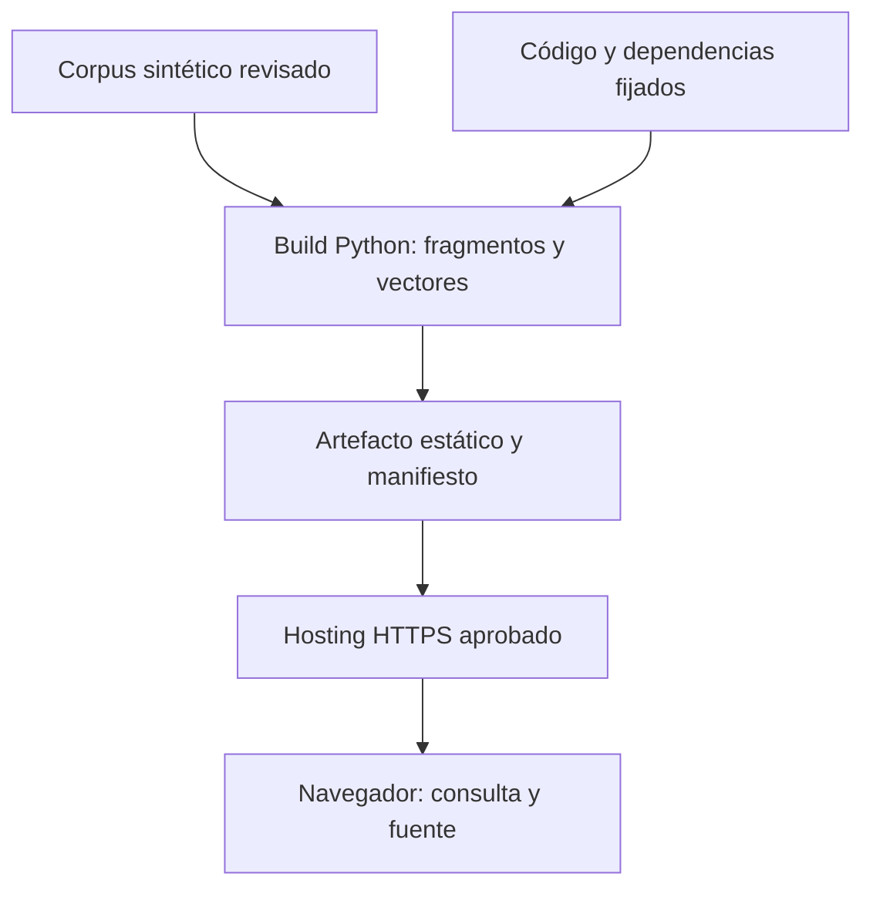

# ForestRAG Public Demo: arquitectura

Fecha: 24-10-2026, America/Santiago. Incremento FREG-PUBLIC-ARCH-001. Proyecto personal independiente; sin información ni infraestructura de ARAUCO. Estados: VERIFICADO (alcance probado), HISTÓRICO, DECLARADO, PROPUESTO, NO VERIFICADO y BLOQUEADO.

## Decisión y alcance

VERIFICADO: candidata de la alternativa D (demo limitada), combinada con B (índice preconstruido). HTML, CSS y módulos JavaScript sin dependencias de ejecución externas. El navegador calcula el embedding léxico SHA256-512 y consulta vectores preconstruidos. No hay servidor Python/SQLite, LLM, tokens de empresa, carga de archivos ni comunicación con el laboratorio de permisos.

Reutilización concreta: build.py importa Source/Page, chunk_pages y LexicalEmbedder del código existente. El motor JavaScript conserva normalización NFD, buckets SHA256, normalización y coseno; nueve entradas se contrastan con Python con tolerancia 1e-6. La recuperación añade coincidencia de dos términos de contenido distintos (uno si la consulta sólo tiene uno) para evitar resultados debidos exclusivamente a stopwords o colisiones. Esto no vuelve semántica la búsqueda.

Hosting es PROPUESTO. La construcción y el uso por navegador en loopback son VERIFICADOS. No existe una URL pública comprobada.

## Componentes y fronteras

| Componente | Responsabilidad | Confianza y límite |
|---|---|---|
| public_demo/corpus.json | Tres documentos ficticios, seis secciones | Autor del build aprueba material; clasificación pública explícita y CC0-1.0 de estos ejemplos |
| public_demo/build.py | Validación, fragmentación 55/10, vectores y empaquetado | Operador offline confiable; no recibe entradas de visitantes |
| release-spec.json | Versión, política, límites y contrato | No configura identidades empresariales |
| dist/public-demo | Siete archivos exactos: index, CSS, dos módulos, corpus, release, .nojekyll | Único directorio publicable; nunca publicar el repositorio completo |
| engine.mjs | Verificación del payload, consulta acotada, ranking | Se ejecuta en dispositivo del visitante; no concede privilegios |
| app.mjs | Interfaz y referencias internas al documento | Datos mediante textContent; sin HTML dinámico, historial ni telemetría propia |
| serve.py | Revisión local de la carpeta exportada | Sólo 127.0.0.1; nunca servidor de producción |

El SHA256 del corpus frente al manifiesto detecta cambios aislados. El manifiesto, JS y contenido comparten autoridad de publicación: un atacante que controle esa autoridad puede sustituirlos juntos. HTTPS, seguridad de GitHub y revisión del despliegue son necesarias; los hashes no sustituyen esas garantías.

## Experiencia

Entrada sin cuenta; explicación del propósito; preguntas sugeridas o consulta libre; filtro documental; hasta tres fragmentos; cita a sección y lectura del documento completo. Estado de versión visible. Responsive CSS y prueba en Chrome con 1440x1080 y 390x844. No se muestran páginas PDF inexistentes: estos documentos tienen secciones.

## Alternativas contrastadas

A, semántica en servidor: mantiene MiniLM/ONNX y Streamlit; precisa medir RAM, arranque y concurrencia en Linux/hosting. No comprobado hoy. B, índice semántico preconstruido: elimina ingestión online pero aún necesita embedding de consulta y proteger compatibilidad/integridad. C, frontend y API separados: añade sesiones, cuotas distribuidas, CORS, TLS y operación; innecesario para seis fragmentos públicos. D, candidata actual: menor alcance y coste; no sirve como prueba de inferencia semántica ni autorización empresarial.

No se modifican componentes centrales para adaptar la demo. No se añade Docker porque no aporta valor al artefacto estático. La plataforma protegida futura debe usar backend con identidad verificada y PDP antes de recuperar, fuentes etiquetadas, reautorización de citas/descargas/historial, revocación, políticas vigentes, límites y auditoría. Ningún documento de esa plataforma debe entrar al build estático.

## Recursos y ciclo de vida

Paquete inicial cercano a 31 KB, medido sin compresión; cifra exacta y SHA en receipt.json de entrega. Cero pesos descargados en ejecución, cero llamadas generativas y cero costes por consulta de IA. El trabajo de búsqueda recae en el navegador y no en una CPU facturable de aplicación. Node local aporta una muestra de 100 consultas, no rendimiento de móviles ni del proveedor.

El despliegue conserva assets inmutables por versión y publica un paquete coherente. La app obtiene corpus/manifiesto con cache:no-store; no crea service worker ni caché de respuestas. Esto no permite revocar copias públicas ya descargadas, ni garantiza purga instantánea de CDN. Retiro seguro de documentos confidenciales y rollback de políticas siguen en FREG-SAH-001.

Fuentes de hosting y contratos: [evaluación](FORESTRAG_HOSTING_EVALUATION.md), [manifiesto y releases](FORESTRAG_VERSIONING_STRATEGY.md).
