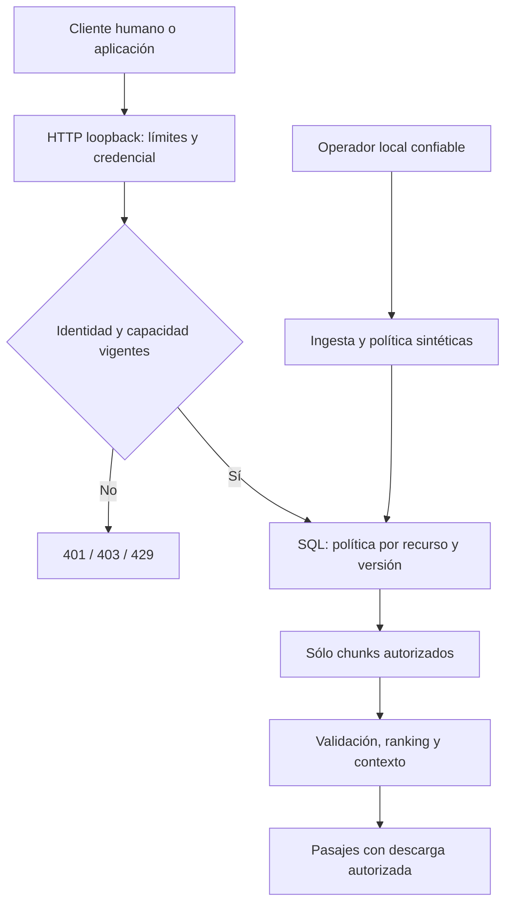

# ForestRAG Security — Threat model

FREG-CRITICAL-001 · 23-10-2026 · alcance VERIFICADO: laboratorio local sintético.
Basado en E00/E04/E06/E07; una revisión integrada del mismo agente, sin pentest externo.

## Activos, actores y fronteras

Activos: texto/documentos, títulos y existencia, chunks/embeddings, políticas,
tokens, historial, archivos descargados, dependencias, fuentes, recursos y auditoría.
Atacantes considerados: usuario sin permiso, cuenta/aplicación comprometida, bot u
otra IA automatizando solicitudes, autor de un documento malicioso y escritor local
del índice. El último supera la frontera confiable actual: no está neutralizado.

Fronteras: cliente→HTTP; token→identidad servidor; política→datos; documento
no confiable→contexto; proceso→disco/operador. Sin herramientas de red/ejecución
para el asistente. CLI pública y laboratorio son bases/esquemas diferentes.
Un atacante con lectura del archivo de credenciales o escritura de la DB puede
suplantar/alterar el laboratorio: permisos de host siguen siendo esenciales.

## Riesgo → control → evidencia

| ID / riesgo | Control actual y estado | Prueba/evidencia | Residual |
|---|---|---|---|
| T01 identidad escrita en chat | Token aleatorio hash/TTL/revocación, VERIFICADO | test_expired_and_spoofed_identity_rejected, E06 | Identidad de persona real no acreditada; bearer robado funciona hasta revocar |
| T02 acceso horizontal/documento adivinado | Predicado SQL antes de payload, misma política en download/history, VERIFICADO | AC03/04/05/08/11, E06 | Sin prueba de canales temporales formales |
| T03 cruce de organización/proyecto/área | Ámbitos acumulativos + grants, VERIFICADO | test_org_area_project_and_grant_are_all_required | Administrador de host puede cambiar DB |
| T04 privilegios por rol/LLM | Ningún bypass admin; no rol en JSON; Restringido bloqueado | AC01/06, HTTP body, E06 | Administración de permisos sólo operador local, no IAM empresarial |
| T05 injection directa/indirecta | Contexto no confiable; sin herramientas; autorización externa, VERIFICADO extractivo | AC06/11 | Resistencia del LLM real NO VERIFICADA |
| T06 exfiltración de citas/metadatos | Resultados sólo autorizados, links internos, errores 404 genéricos | AC03/05/11 y HTTP | No impide que autorizado copie texto legítimo |
| T07 revocación/caché/retención | Revalidación, sin caché de respuesta, referencias versionadas, VERIFICADO | AC07/08/12 | Copias ya entregadas, disco residual/backup no borrados criptográficamente |
| T08 extracción automatizada/agotamiento | Cuota por identidad, concurrencia/hilos, límites de cuerpo/documentos, VERIFICADO parcial | AC09 | Sin análisis conductual, cuota por bytes ni DDoS; múltiples cuentas amplían capacidad |
| T09 envenenamiento del índice | IDs derivados, norma, checksum/inventario, VERIFICADO parcial | F02 regresiones | Checksum coeditable no autentica contra host comprometido |
| T10 parsing PDF/dependencias | pypdf actualizado; entrada acotada; entorno mínimo separado | F04/F06, E08 | Sin sandbox de parsing; Pillow full conserva 35 avisos |
| T11 robo de credenciales de servicio | Token independiente, scope query sin download/history, revocable | test_application_credential_capabilities_separate | No rotación automática/almacén de secretos corporativo |
| T12 manipular logs/cadena de suministro | Sin prompt/token en audit, acciones SHA fijadas heredadas, lock core hashes | AC10, E08, lock | Logs locales alterables, sin SIEM, firma ni monitoreo continuo |

Severidad cualitativa alta para T01–T07/T09–T11 si hubiera datos reales; actualmente
impacto documental limitado a fixtures. No se asigna probabilidad numérica inventada.

## Caso ARTEX y fuentes oficiales consultadas

Microsoft Security (21-10-2026) documenta abuso acelerado de credenciales y permisos
de aplicaciones ya autorizadas, sin depender de inicio de sesión interactivo humano.
Principios inferidos para ForestRAG: identidades de aplicación separadas, permisos
mínimos, revocación y trazabilidad. El laboratorio no integra Microsoft 365 y esos
incidentes no prueban una vulnerabilidad equivalente aquí. No se instaló ARTEX.

| Referencia oficial, consultada 23-10-2026 | Correspondencia concreta | Alcance de uso |
|---|---|---|
| [Microsoft ARTEX](https://www.microsoft.com/en-us/security/blog/2026/10/21/storm-0940-uses-artex-agentic-ai-connectwise-supply-chain-compromise/) | T01/T08/T11, credenciales de aplicación/privilegios | Lecciones defensivas, no ataque reproducido |
| [OWASP GenAI Top 10 2025](https://genai.owasp.org/llm-top-10/) | LLM01→T05, LLM02→T02/T06, LLM03→T10/T12, LLM08→T09, LLM10→T08 | Riesgos seleccionados; sin conformidad integral |
| [OWASP ASVS estable 5.0.0](https://asvs.owasp.org/) | Autenticación, sesión, autorización, validación y logging | Referencia de diseño; sin evaluación requisito por requisito ni nivel certificado |
| [OWASP Authorization](https://cheatsheetseries.owasp.org/cheatsheets/Authorization_Cheat_Sheet.html) | T02/T03, denegación y comprobación por solicitud | Pruebas de recursos y ámbitos |
| [OWASP RAG Security](https://cheatsheetseries.owasp.org/cheatsheets/RAG_Security_Cheat_Sheet.html) | T02/T05/T07/T09: herencia de permisos, contexto, retiro, integridad | Diseñado y probado en alcance acotado |
| [NIST SP 800-207, 2020](https://csrc.nist.gov/pubs/sp/800/207/final) | T01–T03, identidad/recurso antes de acceso | Principios Zero Trust, no despliegue empresarial validado |
| [MITRE ATT&CK T1078](https://attack.mitre.org/techniques/T1078/) | T01/T11, abuso de cuentas válidas | Revocación/scope; no atribución de atacantes |
| [MITRE ATLAS, SAFE-AI](https://atlas.mitre.org/pdf-files/SAFEAI_Full_Report.pdf) | AML.T0051 prompt injection→T05 | Taxonomía confirmada en PDF oficial; página dinámica no recuperable |
| [PyPI pypdf 6.21.2](https://pypi.org/project/pypdf/6.21.2/) | T10, versión/hash del wheel | Wheel contrastado con checksum; no auditoría del mantenedor |

## Revisión de las doce perspectivas

Dirección/arquitectura conserva A1–A5; IA separa extractivo y generación;
recuperación evita llamar holdout a la regresión; datos preserva hash/licencia;
software mantiene módulo aislado; identidad exige token; Zero Trust niega acceso
por defecto; seguridad LLM trata documentos como datos; Red Team usa canarios
ficticios; QA ejecuta HTTP/SQL; DevSecOps separa entorno mínimo y dependencia
vulnerable; auditoría limita el gate a la evidencia. Son perspectivas de esta
ejecución, no firmas ni consenso de profesionales distintos.
