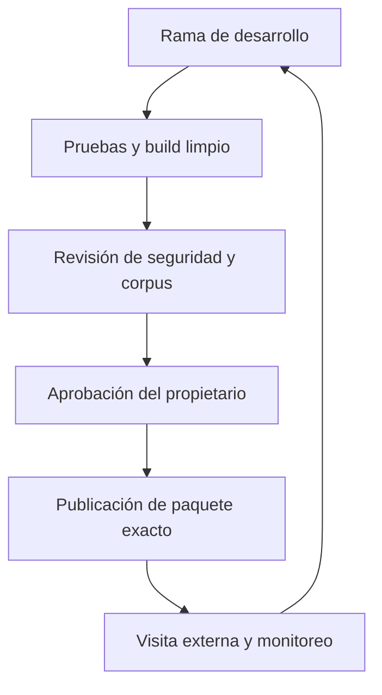

# ForestRAG: estrategia de versiones y releases

Fecha: 24-10-2026, America/Santiago. Incremento FREG-PUBLIC-ARCH-001. Proyecto personal independiente; sin información ni infraestructura de ARAUCO. Estados: VERIFICADO (alcance probado), HISTÓRICO, DECLARADO, PROPUESTO, NO VERIFICADO y BLOQUEADO.

## Convenciones

PROPUESTO para adopción mediante revisión; implementación local del manifiesto VERIFICADA. main será la rama integrada estable cuando se autorice reconciliar el histórico y pasen las pruebas. Por ahora sigue siendo un snapshot antiguo, no se lo redefine por documentación.

Ramas de trabajo cortas: feat/<tema>, fix/<tema>, docs/<tema>, o identificadorFREG vigente cuando ya existe. Conservar freg-public-arch-001 para este incremento. No implantar GitFlow ni reescribir ramas históricas. Cerrar ramas sólo después de integración y conservación del commit en una referencia durable.

- Incremento: FREG-PUBLIC-ARCH-001, identidad del trabajo.
- Candidata de demo: demo-0.1.0-rc.1. El prefijo identifica el componente; la parte0.1.0-rc.1 sigue sintaxis SemVer.
- Futuro tag: demo-v0.1.0-rc.1, sólo tras aprobar y comprobar el release. No se creó ese tag.
- Producto Python: mantiene0.1.0 histórica. Antes de publicar nuevas distribuciones se debe fijar contrato CLI/índice/API y decidir su propia versión.
- Commit: SHA completo, referencia al código. No equivale a aprobación ni a despliegue.

SemVer requiere un contrato público explícito. Para la demo: schema1 del manifiesto/bundle, engine léxico512-v1 y política public-synthetic-only-v1. Cambio incompatible de schema/motor exige nueva versión y reconstrucción; un lector desconocido deniega, no migra silenciosamente. No prometemos estabilidad del core0.x.

Se incorpora .gitattributes: Markdown, locks, demo y evidencia usan LF; fixtures conservan bytes exactos (-text). Evita conversiones CRLF que alteren referencias con hash. No cambia sus bytes o hashes esperados.

## Fuente de verdad

PROJECT_STATUS.md apunta a plan, estado y manifiesto. Git registra código, corpus sintético, locks, decisiones y pruebas. release.json se genera fuera del árbol versionado en dist y liga el paquete al commit limpio, hashes de inputs, dependencias reales y assets. PDF/ZIP incluyen receipt de commit/fecha/SHA; no se editan para simular una versión diferente.

## Componentes reproducibles

| Componente | Identificación | Compatibilidad/restauración |
|---|---|---|
| Código | source_commit y source_inputs SHA256 | Checkout exacto; source_dirty:false para promoción |
| Dependencias build | lock Linux/Py3.12 con hashes; build_runtime Python/NumPy | Lock original no garantiza Windows; no inferir instalación limpia de pip check |
| Dependencias cliente | runtime_dependencies:[] | APIs estándar de navegador; Web Crypto en HTTPS/loopback |
| Corpus | corpus_version, doc id/version/SHA, synthetic/public/active/approval | Nunca aceptar metadatos incompletos; reconstruir al cambiar o retirar |
| Modelo | engine lexical-sha256-512-v1; model_revision:null; generative_model:null | No insinuar pesos semánticos en esta demo |
| Fragmentación | max_words55/overlap10; hashes del preprocesador | Cambio reconstruye vectores y evidencia |
| Índice | corpus.json SHA/tamaño con vectores y procedencia | Rechazo de schema, dimensión, norma, referencias o digest incompatibles |
| BD | database_schema:null en estático | CoreSQLite conserva su contrato; cualquier futura migración tendrá prueba y copia compatible |
| Política | public-synthetic-only-v1 | No es una políticaPDP empresarial; no restaurar grants antiguos en sistema futuro |
| Despliegue | siete assets permitidos y SHA; proveedor/origen en recibo de publicación futuro | No exponer raíz del repo, DB, modelos ni reportes privados |
| Pruebas | XML Python, TAP Node, browser.json | Referenciar corte/código; no sumar mocks a inferencia real |
| Documentación | revisiónGit y fecha del snapshot externo | Viejos entregables permanecen históricos |
| Release | versión candidata + commit + digest externo del ZIP | No reemplazar bytes de un release ya publicado |

## Promoción

No hacen falta tres infraestructuras pagadas: desarrollo local, validación del artefacto en loopback, demo pública después de aprobación. La URL pública es un estado posterior a las pruebas locales, no una consecuencia automática del commit.

Dos rutas de publicación preparadas conceptualmente:

1. Primera demo sin modificar main: tras publicar la rama fuente y aprobarCI, crear una rama de artefacto dedicada con sólo los siete assets. Configurar Pages para esa rama y raíz. Cada actualización requiere build y aprobación; esa rama no es rama de desarrollo ni fuente canónica.
2. Evolución Actions: public_demo/deploy-pages.yml.example es un borrador inactivo. Para habilitar workflow_dispatch enGitHub deberá existir en la rama por defecto; incorporarlo a main requiere autorización adicional. Debe configurarse previamente el entorno forestrag-public-demo y sus revisores/reglas: nombrarlo enYAML no crea protección efectiva. Se fija un SHA fuente exacto, permisos mínimos, build/test y directorio allowlist.

El workflow CI de pruebas sí está preparado bajo .github/workflows, pero no se ejecutó remotamente. Las acciones están fijadas a SHA40 verificados en GitHub; revisar también sus dependencias y el runner. Los permisos de despliegue no aparecen en el job de pruebas.

## Reversión y retirada

Un fallo funcional permite volver al código revisado anterior, reconstruyendo con el corpus/política vigente. No republicar automáticamente un paquete viejo si contiene un documento retirado. Comparar denylist de documentos retirados, referencias, digest y pruebas de consulta antes de promover; ese registro central persistente y su protección son pendientesSAH03, no implementados por la demo.

La prueba local demuestra que reconstruir sin una fuente elimina sus fragmentos del paquete. No demuestra invalidación global de descargas/cachés, ni resistencia a rollback por un publicador comprometido. Copias públicas ya descargadas no pueden revocarse. Datos confidenciales quedan fuera de esta arquitectura.

Fuentes: https://semver.org/ ; https://docs.github.com/en/repositories/releasing-projects-on-github/about-releases ; https://docs.github.com/en/actions/reference/security/secure-use ; https://docs.github.com/en/actions/how-tos/deploy/configure-and-manage-deployments/manage-environments . Consulta24-10-2026.
