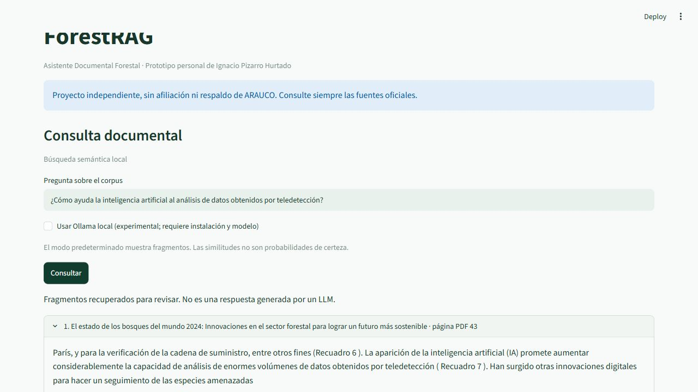

# ForestRAG
### Asistente documental forestal

**Encuentra información en documentos PDF y revisa la fuente y la página que la respaldan.**

ForestRAG es un prototipo personal para consultar información técnica forestal. Combina búsqueda documental, evidencia verificable y un laboratorio de permisos.

**[Probar ForestRAG online](https://ipizarroh.github.io/forest-rag-asistente-documental/)** - demo pública con tres documentos ficticios, búsqueda de evidencia y citas. Se abre sin registro ni instalación. [Estado y límites](PROJECT_STATUS.md) · [Guía de uso](docs/probar-demo-publica.md).

[Cómo probarlo](#cómo-probarlo) · [Seguridad documental](#seguridad-documental) · [Documentación técnica](#para-profundizar)

## Del documento a la información útil

Buscar un dato entre informes, manuales y procedimientos puede exigir revisar muchas páginas. ForestRAG localiza pasajes relacionados con una pregunta y permite comprobar su procedencia.

Podría ser útil para profesionales de operaciones, análisis e innovación que trabajan con documentación extensa. Actualmente se demuestra con un corpus público pequeño; su utilidad en una organización todavía debe evaluarse.

## Cómo funciona

**PDF autorizado → preparación del texto → búsqueda → evidencia con fuente y página → resultado para el usuario.**

El sistema divide el texto y busca fragmentos relacionados con la pregunta, aunque se usen palabras distintas.

RAG significa *generación aumentada por recuperación*: buscar evidencia documental para apoyar una respuesta. **ForestRAG hoy muestra los pasajes recuperados. La generación con un modelo de lenguaje real sigue pendiente de validación.**



*Captura real del prototipo local con texto de FAO. Muestra evidencia recuperada; no una respuesta redactada por un modelo de lenguaje.*

## Qué puedes hacer hoy

**Prototipo documental**

- Consultar texto de dos páginas de una publicación de FAO sobre innovación forestal mediante búsqueda semántica local.
- Revisar fragmentos con su fuente y página desde la interfaz web local o la línea de comandos.
- Probar una demostración con un documento ficticio, sin descargar modelos ni PDF.

Por ejemplo: «¿Cómo ayuda la inteligencia artificial al análisis de datos obtenidos por teledetección?». El resultado permite volver a la página del documento y contrastar la información. La recuperación puede ser incompleta; no garantiza una respuesta correcta.

**Laboratorio de seguridad separado**

- Comparar la misma consulta entre identidades ficticias de Operaciones, Recursos Humanos, otra organización y una aplicación.
- Comprobar permisos por documento, descargas protegidas, revocación y límites de consultas.

El laboratorio utiliza exclusivamente documentos inventados. **Sus permisos todavía no están integrados en la interfaz documental pública.**

## La experiencia que buscamos construir

**Visión futura — pendiente de implementación y validación.**

Una persona ingresaría con identidad empresarial verificada, consultaría documentos autorizados para su área o proyecto y recibiría respuestas con evidencia y fuentes vigentes.

La información de otras áreas requeriría autorización. La experiencia buscaría ser sencilla y auditable.

Llegar a esa experiencia exige integrar identidad, permisos y recuperación; mejorar las respuestas; y validar actualización, seguridad y operación. Sin fecha de lanzamiento comprometida.

## Seguridad documental

La regla es sencilla: **cada persona o aplicación debe acceder únicamente a la documentación que tiene autorizada**. Los permisos los verifica el sistema antes de recuperar el contenido; escribir «soy administrador» en una pregunta no concede acceso.

El laboratorio prueba ese principio con datos ficticios e intentos de manipulación. El nivel Restringido permanece bloqueado. Autenticación empresarial y multifactor, protección del equipo y validación con información confidencial real siguen pendientes.

[Conocer el laboratorio](docs/security-lab.md) · [Diseño de permisos](FORESTRAG_ACCESS_CONTROL_DESIGN.md) · [Amenazas y límites](FORESTRAG_SECURITY_THREAT_MODEL.md)

## Cómo probarlo

**En navegador:** abre [la demo pública](https://ipizarroh.github.io/forest-rag-asistente-documental/) y elige una pregunta sugerida.

**En tu computador:** necesitas Python y una copia de esta rama. Sigue la [guía de instalación y demostraciones](docs/probar-forestrag.md) para preparar el entorno.

**Primera prueba: documento ficticio, sin descargar modelos.**

```bash
python -m forestrag.cli demo
```

**Prueba de permisos: laboratorio local independiente.**

```bash
python -m forestrag.security_http init
python -m forestrag.security_http serve
```

Con el servidor abierto, ejecuta `python scripts/demo_security.py` desde otro terminal con el mismo entorno. Compara cinco identidades sin mostrar sus credenciales.

La guía también explica cómo preparar el corpus público y abrir la interfaz web de la captura.

## Tecnologías principales

- **Python:** procesamiento de documentos y lógica del asistente.
- **MiniLM multilingüe y ONNX Runtime:** búsqueda por relación entre el significado de la pregunta y el texto.
- **SQLite:** almacenamiento local del índice y de los datos del laboratorio, en bases separadas.
- **Streamlit:** interfaz del prototipo documental.

## Estado y próximos pasos

La rama [freg-public-arch-001](https://github.com/ipizarroh/forest-rag-asistente-documental/tree/freg-public-arch-001) publica el código completo revisado de esta candidata, incluidos el prototipo local y el laboratorio. La demo web se despliega desde una rama separada de siete archivos estáticos. main conserva el corte histórico.

- **Implementado:** recuperación documental local, trazabilidad, laboratorio sintético separado y demo web pública de búsqueda léxica.
- **Verificado en GitHub:** 106 pruebas aprobadas por entorno de Python, 13 pruebas de construcción, 15 de JavaScript y 12 comprobaciones externas de la demo, con vista móvil emulada. [Informe y evidencias](FORESTRAG_INFORME_PUBLICACION_GO_001.md). Las suites se solapan y no se suman como cobertura. La semántica y la generación online siguen pendientes.
- **Después:** ciclo de actualización y retiro documental, identidad empresarial e integración de permisos; generación con un modelo real cuando se satisfagan sus dependencias.

El [plan integrado](FORESTRAG_PLAN_MAESTRO_INTEGRADO.md) conserva las etapas y sus criterios de aceptación.

## Para profundizar

- [Instalación y demostraciones](docs/probar-forestrag.md)
- [Arquitectura y decisiones técnicas](docs/arquitectura.md)
- [Evaluación, resultados y limitaciones](docs/evaluacion.md)
- [Reproducción y evidencias de FREG-002](docs/reproduce-freg002.md)
- [Estado maestro y continuidad](FORESTRAG_ESTADO_MAESTRO_Y_CONTINUIDAD.md)
- [Informe del cambio de presentación](FORESTRAG_INFORME_INCREMENTO_ACTUAL.md)

## Autoría y fuentes

Proyecto personal de [Ignacio Pizarro Hurtado](https://github.com/ipizarroh), independiente y sin afiliación, patrocinio ni aprobación de ARAUCO. No utiliza información interna de empresas.

El corpus demostrativo utiliza texto de *El estado de los bosques del mundo 2024* (FAO), bajo CC BY 4.0, con atribución y alcance en [fuentes y licencias](docs/fuentes.md). No implica respaldo de FAO. Código bajo [MIT](LICENSE). El corpus ficticio de la demo estática se declara CC0-1.0 en su manifiesto; otros ejemplos conservan sus licencias documentadas.
