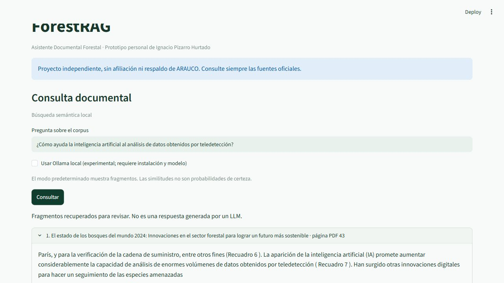

# ForestRAG · Consulta documental local con evidencia

ForestRAG es un proyecto personal de **Ignacio Pizarro Hurtado**, Ingeniero Civil Industrial. Nació para consultar documentos forestales y explora cómo ayudar a encontrar información, ponerla en contexto y comprobar de qué página proviene. El prototipo público permite formular una pregunta y revisar pasajes con su fuente y página.

## Para qué sirve

Encontrar una condición, una excepción o una cifra dentro de muchos documentos puede tomar más tiempo que leer el pasaje que la explica. ForestRAG desarrolla una forma de acortar esa búsqueda y mantener visible la evidencia que permite revisar el resultado.

La demostración pública consulta texto de una publicación de la FAO. Comparar condiciones en dos versiones de un procedimiento o señalar que falta evidencia para responder son **ejemplos de uso futuro**. Aplicarlo a otros sectores requerirá validación con corpus autorizados de esos ámbitos.

## Cómo funciona

El prototipo publicado extrae y fragmenta texto por página. Usa representaciones numéricas multilingües de texto (*embeddings*) para buscar pasajes similares en un índice SQLite. La interfaz permite revisar los resultados y su procedencia.

**Arquitectura objetivo.** El diagrama agrupa pasos de la evolución del sistema. El estado de cada capacidad se indica debajo.

~~~mermaid
flowchart LR
    A["Documentos autorizados"] --> B["Extracción, estructura e índice"]
    B --> C["Recuperación y ranking"]
    C --> D["Suficiencia, generación y verificación"]
    D --> E["Respuesta con evidencia"]
~~~

| Estado al 20 de noviembre de 2026 | Alcance |
|---|---|
| **Publicado** | Extracción PDF con pypdf, búsqueda semántica local, demo léxica sin pesos, CLI y Streamlit. La evaluación pública inicial registró 40 pruebas aprobadas, página esperada en 6/6 consultas respondibles y todos los términos de referencia en 4/6. El adaptador Ollama se probó con transporte simulado en esta versión. |
| **Laboratorio** | ARCH-006 obtuvo GO limitado para cimentación. ARCH-007 FIX04 registró 4/4 PDF sintéticos con Docling real en Windows. La estructura, el Markdown derivado y el índice auxiliar son experimentales. **ARCH-007 sigue en NO-GO para aprobación completa.** |
| **Planificado** | Evaluar la recuperación híbrida, el ranking y la suficiencia por separado. Avanzar hacia respuestas fundamentadas que indiquen contradicciones o se abstengan ante evidencia insuficiente. |

Los resultados públicos corresponden a una evaluación de desarrollo sobre dos páginas. La cobertura de una página y la suficiencia del contenido se miden por separado. Consulta las [mediciones publicadas](docs/evaluacion.md) y el [estado del laboratorio](docs/ESTADO_Y_ROADMAP.md).

## Investigación y calidad

El desarrollo combina ingeniería de software, estadística, IA y recuperación de información, investigación de operaciones y mejora continua. La práctica es **investigar antes de decidir, medir antes de optimizar y verificar antes de aprobar**. Se registran hipótesis, pruebas, límites y decisiones para que cada avance pueda revisarse. [Fundamentos y metodología](docs/FUNDAMENTOS_Y_METODOLOGIA.md)

Seguridad, evaluación científica y funcionamiento básico son transversales. El diseño prioriza el procesamiento local, corpus públicos autorizados o sintéticos, originales preservados, procedencia, versiones e integridad mediante SHA-256. Una cita debe llevar al pasaje correcto y su contenido debe respaldar la afirmación. El prototipo es de uso individual y corre en loopback. [Controles y límites de seguridad](docs/seguridad.md)

## Roadmap

| Etapa | Enfoque |
|---|---|
| ARCH-006 | Cimientos, diagnóstico, contratos, seguridad y evaluación |
| ARCH-007 | Comprensión documental, Markdown y fidelidad |
| ARCH-008 | FTS5, embeddings locales y recuperación híbrida con RRF |
| ARCH-009 | Ranking, reranking y selección de evidencia |
| ARCH-010 | Suficiencia, cobertura y contradicciones |
| ARCH-011 | Generación fundamentada y verificación de afirmaciones |
| ARCH-012 | Integración objetivo V0.4, regresiones, seguridad y rendimiento |

Los criterios de salida están en el [roadmap técnico](docs/ESTADO_Y_ROADMAP.md).

## Ejecutar el prototipo publicado

Python 3.11 o superior. Desde una terminal:

~~~bash
git clone https://github.com/ipizarroh/forest-rag-asistente-documental.git
cd forest-rag-asistente-documental
python -m venv .venv
~~~

Activa el entorno con `source .venv/bin/activate` en Linux/macOS o `.\.venv\Scripts\Activate.ps1` en PowerShell. También puedes usar directamente el ejecutable Python del entorno virtual.

~~~bash
python -m pip install -r requirements.txt
python -m forestrag.cli demo
~~~

La demo usa un documento ficticio. Instalar dependencias requiere conexión y la demo léxica funciona sin descargar corpus ni modelos. La [guía de evaluación](docs/evaluacion.md) explica cómo preparar la consulta semántica con el PDF público. Tras preparar el índice puedes abrir Streamlit con `python -m streamlit run app/streamlit_app.py` y visitar `http://127.0.0.1:8501`.

## Documentación y autoría

- [Arquitectura pública y objetivo](docs/arquitectura.md) · [Recorrido técnico publicado](docs/metodologia_rag.md)
- [Evaluación reproducible](docs/evaluacion.md) · [Resultados](docs/evaluation_results.json) · [Registro de pruebas](docs/test_results.json)
- [Seguridad](docs/seguridad.md) · [Limitaciones](docs/limitaciones.md) · [Fuentes y licencias](docs/fuentes.md)

Proyecto independiente de ingeniería e investigación aplicada, sin afiliación, patrocinio ni aprobación de ARAUCO. El corpus de demostración utiliza texto de dos páginas autorizadas de *El estado de los bosques del mundo 2024* (FAO, [DOI](https://doi.org/10.4060/cd1211es), CC BY 4.0). El código y el material ficticio original se publican bajo [MIT](LICENSE). Las publicaciones, dependencias y pesos de terceros conservan sus licencias. El desarrollo se rige por un presupuesto monetario adicional de cero.
